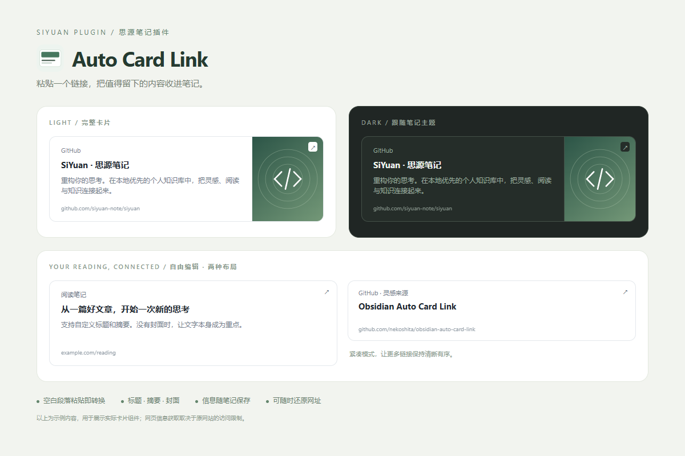

# Auto Card Link · 思源自动链接卡片

把网址收进笔记，也把标题、摘要和封面一起留下。



参考 [Obsidian Auto Card Link](https://github.com/nekoshita/obsidian-auto-card-link) 的使用体验，针对思源的编辑器与挂件块重新实现。独立实现，未复制原插件源码。

## 使用

- 在**空白段落**粘贴一个网页网址，自动获取信息并生成卡片。
- 在编辑器按 **Ctrl+Shift+K**（macOS 为 **⌘⇧K**），打开插入窗口。选中的网址可自动带入，卡片插在当前块后。
- 输入 `/cardlink` 或 `/链接卡片`，选择插入卡片。
- 点击卡片打开原网页。点击卡片块左侧块标，选择**编辑链接卡片**、**重新获取封面**、**复制原网址**或**还原为普通链接**。
- 插入窗口先点**获取网页信息**，也可以直接手动填写后保存。编辑已有卡片时，重新获取会覆盖填写的信息。

自动转换只处理空白可编辑段落中的单个 HTTP(S) 网页链接。选中文字、正文中粘贴、代码、表格、图片地址、文件、思源内部复制保持宿主行为。可在插件设置关闭自动转换。

## 安装

1. 从 [Releases](https://github.com/We-Sky/siyuan-auto-card-link/releases) 下载 `package.zip`。
2. 在思源 **设置 → 关于 → 数据存储位置** 找到工作空间，将压缩包内容解压到 `data/plugins/siyuan-auto-card-link/`。该目录内应直接包含 `plugin.json`、`index.js`、`card.html`，不要多套一层目录。
3. 重启思源，在 **设置 → 集市 → 已下载 → 插件** 中启用“自动链接卡片”。

发布到 GitHub 不等同于已收录思源集市。当前提供手动安装包。

## 数据、隐私与兼容性

- 使用思源原生 iframe 挂件块。标题、摘要、目标网址及图片地址直接保存在块内，不依赖在线预览服务；重新打开笔记不会重新抓取网页元信息。
- 网页信息通过思源内核的 `forwardProxy` 请求目标网站，默认超时 7 秒。登录限制、验证码、反爬和完全依赖 JavaScript 的网页可能抓不到；会保存原网址并提示，可手动补充。
- 默认通过思源内核带原网页 Referer 下载封面，校验图片内容后保存到 `assets/`（最大 8 MiB，支持 JPEG/PNG/WebP/GIF/AVIF）。本地封面随笔记同步，挂件通过 `custom-data-assets` 引用附件。下载失败会保留远程地址，并可通过内核重试；仍可能受网站登录、验证码或地址过期限制。图标仍为远程加载。可在设置关闭本地缓存或远程请求；关闭远程图片时已有本地封面仍显示。不向第三方预览平台发送网址。
- 封面解析包括 B 站视频信息接口、BV/AV 视频地址和 b23 短链接、抖音公开页面数据、Open Graph/Twitter 元信息、JSON-LD、文章正文懒加载图片。抖音可能返回验证页面，**不保证抖音链接能成功获取**，不会执行验证脚本或读取登录 Cookie。
- 从 0.1.0 升级后，已有卡片不会自动改写。通过块菜单选择**重新获取封面**可补图并存为附件，保留标题与摘要；获取失败则保留原卡片。
- 卡片跟随思源主题。支持普通和紧凑布局，单张卡片可以覆盖默认设置。紧凑布局隐藏摘要，**保留封面**，高度为 112px；封面区域宽 188px（窄屏最多占 45%）。普通布局显示摘要和封面，高度为 156px，封面区域约占宽度 34%，最大 280px。封面完整显示，不裁切画面，比例不同时可能留白。
- 同步到其他设备后也需要安装此插件，才能加载 `/plugins/siyuan-auto-card-link/card.html`。关闭插件通常仍可读取已安装的静态挂件文件；**卸载前请将需要的卡片还原为普通链接**。
- Markdown 导出保留 iframe 及其数据，不会导出为 Obsidian 的 `cardlink` YAML；其他 Markdown 软件及独立 HTML/PDF 导出不保证显示卡片。当前不提供 Obsidian 历史卡片批量导入。
- 最低思源版本 3.8.9。已通过自动测试、浏览器显示检查，以及思源 3.8.9 自带 Lute 解析器的原生挂件与导出再导入验证；尚未完成真实思源编辑器中的端到端验证。浏览器与移动端声明支持，但仍需对应设备实测。

## 开发

Node.js 22.12+：

```sh
npm ci
npm run package
```

得到 `dist/` 和 `artifacts/package.zip`。主插件将 `siyuan` 设为外部依赖，发行包无需安装 npm 依赖。测试涵盖信息解析、数据转义、超时降级、粘贴保护及卸载时的粘贴恢复。GitHub Actions 对提交运行相同检查。

0.1.1 在本机思源 3.8.9 内核上实测：B 站公开视频 `BV1GJ411x7h7` 的封面及 [GitHub Blog 文章](https://github.blog/engineering/infrastructure/introducing-glb/) 配图均成功保存为本地附件；抖音样例返回验证页面，未成功获取封面。此验证覆盖真实网络与附件接口，不代表已完成所有平台或完整编辑器交互测试。

运行 `node scripts/preview.mjs`，访问 `http://127.0.0.1:4173` 查看实际卡片组件的示例。可用 `node scripts/verify-lute.cjs "思源 resources/stage/protyle/js/lute/lute.min.js 的绝对路径"` 检查本机思源解析器中的挂件识别与数据往返。

## 参考与许可

- 使用体验：[nekoshita/obsidian-auto-card-link](https://github.com/nekoshita/obsidian-auto-card-link)（MIT）。
- 接口参考：[siyuan-note/petal](https://github.com/siyuan-note/petal)、[plugin-sample](https://github.com/siyuan-note/plugin-sample) 与 [思源源码](https://github.com/siyuan-note/siyuan)。
- 本项目采用 MIT 许可。
